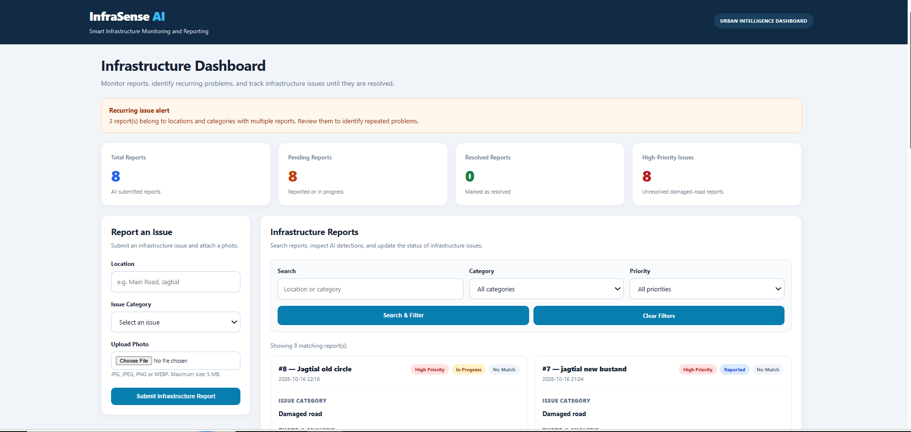
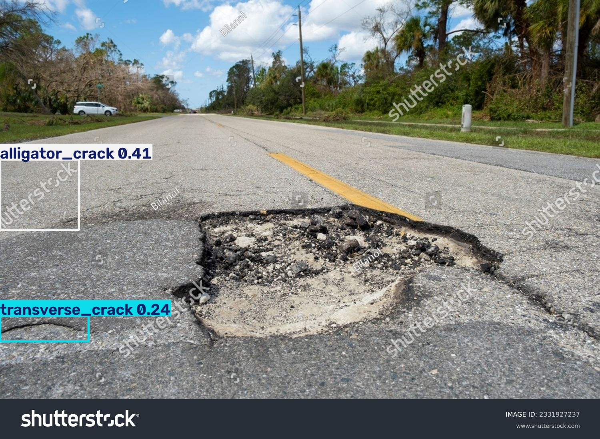

# InfraSense AI

AI-powered road damage detection and reporting dashboard built with Python and Flask.

## Features

- Submit road damage reports with photos.
- Detect road damage using a YOLO-based model.
- Analyze potential damage regions using OpenCV.
- Track report status: Reported, In Progress, and Resolved.
- Identify recurring issues by location and category.
- View report priorities and AI analysis results through a dashboard.

## Technologies Used

- Python
- Flask
- SQLite
- OpenCV
- YOLO
- HTML and CSS

## Getting Started

1. Clone this repository:

   ```bash
   git clone https://github.com/subi05237asmi/InfraSense-AI.git
   cd InfraSense-AI
   ```

2. Create and activate a virtual environment:

   ```powershell
   python -m venv .venv
   .venv\Scripts\Activate.ps1
   ```

3. Install the Python packages required by the project.

   Check the imports in `app.py` and `road_detector.py` to determine the dependencies.

4. Run the Flask application using the startup instructions in `app.py`.

## Notes

- The application uses a local SQLite database.
- Uploaded photos and generated AI analysis results are stored locally.
- AI detections are predictions and should be reviewed before making maintenance decisions.

## Author

GitHub: [@subi05237asmi](https://github.com/subi05237asmi)

## Dashboard Preview



## AI Road Damage Detection

The YOLO model analyzes road images to identify potential damage, including cracks and potholes.



## System Workflow

1. **Report Submission:** A user enters the location, selects an issue category, and uploads a road photo.
2. **AI Detection:** The YOLO model analyzes the image for potential road damage.
3. **Image Processing:** OpenCV identifies additional candidate regions for inspection.
4. **Report Management:** Flask handles report submission, search, filtering, and status updates.
5. **Data Storage:** SQLite stores report information locally.
6. **Dashboard:** The dashboard displays report statistics, priorities, recurring issues, and analysis results.

## Limitations

- AI predictions are not guaranteed to be accurate and should be reviewed by a human.
- OpenCV candidate regions are image-processing results, not confirmed damage.
- The SQLite database and uploaded photos are stored locally by default.
- The application currently runs locally and is not automatically a publicly hosted website.
